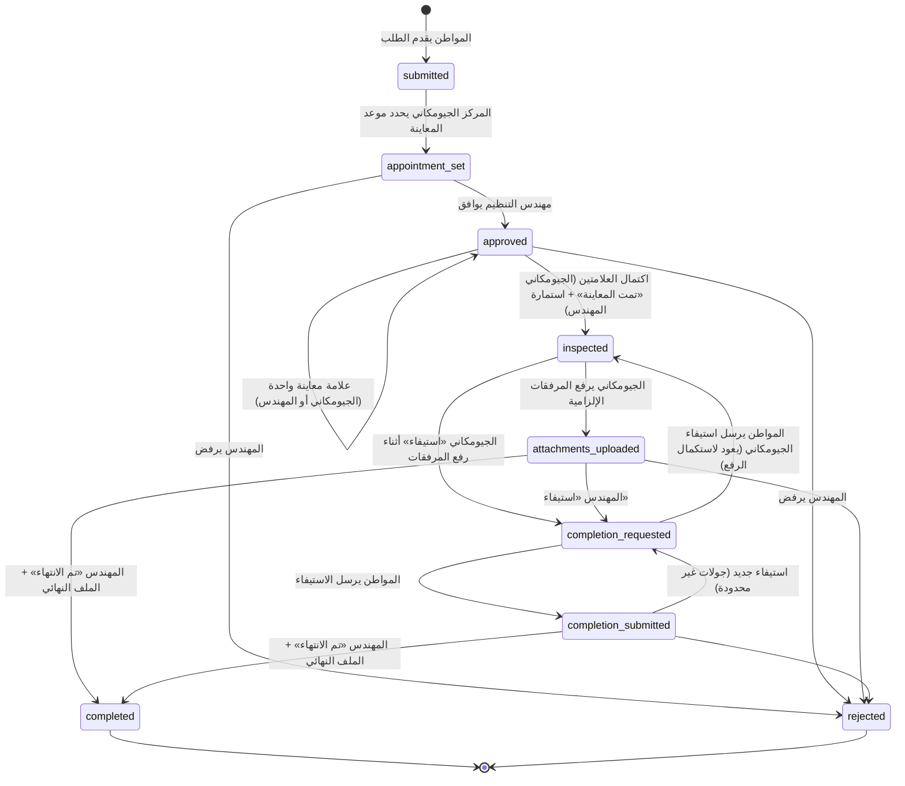

# دليل خدمة «طلب صلاحية الموقع»

> بوابة محافظة كفر الشيخ — الوحدة `modules/SiteValidity` (Modules\SiteValidity)
> آخر تحديث: 2026-10-09

## 1. الغرض من الخدمة

خدمة إلكترونية تمكّن المواطن من التقدم بطلب **صلاحية الموقع** (للبناء أو توصيل المرافق أو التصالح أو المشروعات الاستثمارية) دون زيارة المركز، ومتابعة الطلب عبر المراحل:

تقديم الطلب ← تحديد موعد المعاينة (المركز الجيومكاني) ← موافقة مهندس التنظيم ← المعاينة الميدانية (الطرفان) ← رفع المرفقات الفنية (الرفع المساحي وملف الكاد) ← قرار المهندس (استيفاء أو انتهاء) ← تنزيل الملف النهائي.

كل خطوة تُسجَّل في **سجل تدقيق** (من، متى، من حالة إلى حالة، ملاحظات)، وتُرسل **إشعارات** (داخل البوابة/اللوحة + البريد الإلكتروني) للفاعل التالي وللمواطن.

## 2. الأدوار والحسابات التجريبية

| الدور | اسم الدور التقني | أين يعمل | ماذا يفعل |
|---|---|---|---|
| المواطن | (بدون دور) | البوابة العامة `/site-validity-request` | يقدم الطلب، يسدد الرسوم، يرد على الاستيفاء، ينزل الملف النهائي |
| المركز الجيومكاني | `geo_center` | لوحة `/site-validity` | يحدد موعد المعاينة، يسجل «تمت المعاينة»، يرفع المرفقات الفنية، يطلب الاستيفاء أثناء رفع المرفقات |
| مهندس التنظيم | `planning_engineer` | لوحة `/site-validity` | يوافق/يرفض، يملأ استمارة المعاينة، يطلب الاستيفاء، ينهي الطلب ويرفع الملف النهائي |
| مسؤول الخدمة | `site_validity_admin` | لوحة `/site-validity` | كل ما سبق + الإعدادات + الحسابات + التعديل الإداري والإسناد والتقارير |
| السوبر أدمن | `super_admin` | كل اللوحات | يعامل كمسؤول الخدمة |

### الحسابات التجريبية (تُنشأ بواسطة `SiteValidityDemoSeeder`)

كلمة المرور: قيمة `DEMO_PASSWORD` في `.env` إن وُجدت، وإلا **`SvDemo@2026#Kfs`**.

| الحساب | البريد (دخول اللوحة) | الرقم القومي (دخول بوابة المواطن) | الدور |
|---|---|---|---|
| مسؤول صلاحية الموقع | `sv.admin@demo.kfs.invalid` | 28503151500231 | site_validity_admin |
| المركز الجيومكاني | `sv.geo@demo.kfs.invalid` | 28807221500342 | geo_center |
| مهندس التنظيم | `sv.engineer@demo.kfs.invalid` | 28611041500153 | planning_engineer |
| مواطن 1 (محمود إبراهيم السيد الجمل) | `sv.citizen1@demo.kfs.invalid` | 29004121500575 | مواطن |
| مواطن 2 (هبة مصطفى علي قنديل) | `sv.citizen2@demo.kfs.invalid` | 29309051500686 | مواطن |

> القائمة نفسها مضافة في نهاية `storage/app/private/demo-accounts.txt`.

### الروابط

| الصفحة | الرابط |
|---|---|
| صفحة الخدمة (عامة) | `/site-validity-request` |
| نموذج التقديم (يتطلب دخول) | `/site-validity-request/apply` |
| طلباتي | `/site-validity-request/my-requests` |
| تفاصيل طلب | `/site-validity-request/requests/{id}` |
| لوحة الموظفين | `/site-validity` (الدخول: `/site-validity/login` بالبريد وكلمة المرور) |

الخدمة مضافة أيضاً إلى: قائمة «الخدمات الإلكترونية» في رأس الموقع (سطح المكتب والجوال)، شبكة الخدمات السريعة في الصفحة الرئيسية، والقائمة الجانبية للوحة المواطن («طلباتي ← صلاحية الموقع»).

## 3. سير العمل والحالات



| الحالة (المفتاح) | التسمية الافتراضية | من ينفذ الخطوة التالية | الإجراءات المتاحة |
|---|---|---|---|
| `submitted` | جديد — بانتظار تحديد موعد المعاينة | المركز الجيومكاني | تحديد الموعد |
| `appointment_set` | تم تحديد الموعد — بانتظار موافقة مهندس التنظيم | المهندس (والجيومكاني لإعادة الجدولة) | موافقة / رفض / تعديل الموعد |
| `approved` | معتمد — بانتظار المعاينة | الطرفان (من يوم الموعد) | «تمت المعاينة» (الجيومكاني)، «استمارة المعاينة» (المهندس)، رفض، تعديل الموعد قبل أي علامة |
| `inspected` | تمت المعاينة — بانتظار رفع المرفقات | المركز الجيومكاني | رفع المرفقات / استيفاء |
| `attachments_uploaded` | بانتظار قرار مهندس التنظيم | المهندس | استيفاء / تم الانتهاء / رفض |
| `completion_requested` | مطلوب استيفاء من المواطن | المواطن | إرسال الاستيفاء (يعود للجيومكاني إن طلبه قبل رفع المرفقات، وإلا للمهندس) |
| `completion_submitted` | تم الاستيفاء — بانتظار مراجعة المهندس | المهندس | استيفاء جديد / تم الانتهاء / رفض |
| `completed` | منتهي — الملف النهائي متاح | — | تنزيل الملف النهائي (المواطن والمركز الجيومكاني) |
| `rejected` | مرفوض | — | — |

**قواعد مهمة**

* **قاعدة المعاينة المزدوجة:** لا ينتقل الطلب إلى «تمت المعاينة» إلا بعد تسجيل **العلامتين معاً**: علامة المركز الجيومكاني وعلامة مهندس التنظيم (استمارة المعاينة). الترتيب غير مهم، وكل علامة تُسجل مرة واحدة.
* لا يمكن تسجيل المعاينة **قبل يوم الموعد** (إعداد «منع تسجيل تمت المعاينة قبل يوم الموعد» — مفعل افتراضياً؛ مسؤول الخدمة مستثنى).
* يجب أن يكون موعد المعاينة في المستقبل. تعديل الموعد مسموح حتى تُسجل أول علامة معاينة.
* لا تُرفع المرفقات إلا بعد اكتمال المعاينة، ولا يحال الطلب للمهندس إلا بعد رفع **كل أنواع المرفقات الإلزامية**.
* المركز الجيومكاني يطلب الاستيفاء في مرحلة رفع المرفقات فقط، ورد المواطن يعيد الطلب إليه («تمت المعاينة») لاستكمال الرفع. بعد رفع المرفقات يكون الاستيفاء للمهندس فقط.
* لا يمكن للمهندس «تم الانتهاء» قبل رفع المرفقات (ولا أثناء انتظار رد المواطن على الاستيفاء).
* **الدفع:** افتراضياً تُعرض الرسوم وزر السداد ولا يتوقف سير العمل على السداد. عند تفعيل «السداد إلزامي قبل المعالجة» لا يستطيع المركز الجيومكاني تحديد الموعد قبل السداد.
* كل التحولات تمر عبر صنف واحد: `Modules\SiteValidity\Services\WorkflowService` (التحقق من الدور × الحالة × قواعد العمل، ثم التسجيل والإشعار).

## 4. دليل المواطن (خطوة بخطوة)

1. افتح **الخدمات الإلكترونية ← طلب صلاحية الموقع** واقرأ الخطوات والمستندات المطلوبة والرسوم.
2. اضغط «تقديم طلب جديد». إن لم تكن مسجلاً ستُوجَّه لتسجيل الدخول (بالرقم القومي وكلمة المرور) ثم تعود للنموذج.
3. النموذج على 5 خطوات:
   1. **الخدمة:** اختر نوع الخدمة (تظهر رسومها).
   2. **البيانات الشخصية:** الاسم والرقم القومي والمحمول (مملوءة من حسابك).
   3. **الموقع:** المركز ثم المدينة أو القرية (تُحمّل تلقائياً حسب المركز)، والعنوان، وملاحظات اختيارية.
   4. **المستندات:** الكروكي، صورة عقد الملكية، صورة البطاقة (PDF أو JPG/PNG حتى 5 م.ب لكل ملف) مع معاينة فورية.
   5. **المراجعة والرسوم:** راجع البيانات وقيمة الرسوم، ووافق على الإقرار، ثم «إرسال الطلب».
4. تظهر صفحة نجاح برقم الطلب (مثال `SV-2026-000017`) وزر «سداد الرسوم الآن».
5. من **«طلباتي»** (أو لوحة المواطن ← صلاحية الموقع) تتابع الحالة، موعد المعاينة، والمؤشر المرحلي.
6. **السداد:** زر «سداد … ج.م إلكترونياً» يحولك إلى منظومة e-Finance؛ بعد النجاح تظهر علامة «مدفوع» ومرجع الدفع.
7. **الاستيفاء:** عند طلب المهندس استيفاءً تصلك رسالة، ويظهر في صفحة الطلب صندوق «مطلوب استيفاء» بملاحظات المهندس وقائمة المطلوب؛ اكتب ردك وارفع حتى 5 مستندات ثم «إرسال الاستيفاء». يمكن تكرار ذلك أكثر من مرة ويُحفظ السجل كاملاً.
8. **الانتهاء:** يظهر صندوق «الملف النهائي جاهز» مع زر التنزيل.

## 5. دليل المركز الجيومكاني

* ادخل `/site-validity/login` ببريدك. لوحة التحكم تعرض: بانتظار تحديد موعد، رفع المرفقات، المعاينات، المواعيد المتأخرة… وجدول «مواعيد المعاينة القادمة والمتأخرة».
* **الطلبات ← تبويب «بانتظار تحديد موعد»** (التبويب الافتراضي لك) ← افتح الطلب ← زر **«تحديد موعد المعاينة»** (التاريخ والوقت + ملاحظات للمواطن). يمكن تعديل الموعد لاحقاً حتى أول علامة معاينة.
* بعد موافقة المهندس يظهر الطلب في تبويب **«المعاينات»**. في يوم الموعد أو بعده اضغط **«تمت المعاينة (المركز الجيومكاني)»** مع ملاحظات اختيارية.
* عند اكتمال علامتك وعلامة المهندس ينتقل الطلب لتبويب **«رفع المرفقات»**: زر **«رفع المرفقات»** يعرض حقلاً لكل نوع مرفق مفعل (الرفع المساحي، ملف الكاد، صور الموقع…) مع الامتدادات المسموحة والحجم الأقصى. الأنواع الإلزامية مطلوبة.
* بعد انتهاء المهندس يمكنك تنزيل **الملف النهائي** من قسم «الملفات» في صفحة الطلب.

## 6. دليل مهندس التنظيم

* التبويب الافتراضي لك **«بانتظار الموافقة»**؛ لا تظهر لك الطلبات قبل تحديد موعدها.
* **موافقة / رفض:** زر «موافقة» (مع ملاحظات اختيارية) أو «رفض» (سبب إلزامي يظهر للمواطن).
* **شاشة المعاينة:** في يوم الموعد اضغط **«استمارة المعاينة — تمت المعاينة»**. الاستمارة ديناميكية (يحددها المسؤول): مثل «هل يوجد حدود؟»، «هل يوجد بروز؟»، «هل يوجد ارتداد؟»، «عرض الشارع»، «نوع الأرض»، «المساحة»، «حالة المرافق»، «ملاحظات». البنود الإلزامية مطلوبة، وتُحفظ الإجابات مع نص السؤال وقت المعاينة.
* بعد رفع المرفقات يظهر الطلب في تبويب **«قرار المهندس»**:
  * **«استيفاء»:** اكتب المطلوب من المواطن + قائمة اختيارية بالمستندات (Tags). يعود الطلب للمواطن ثم إليك بعد رده (تبويب «قرار المهندس» مجدداً).
  * **«تم الانتهاء»:** ارفع **الملف النهائي** (PDF / صور / DWG / DXF / ZIP حتى 20 م.ب) وملاحظات اختيارية تظهر للمواطن.

## 7. دليل مسؤول الخدمة

من مجموعة **«إعدادات الخدمة»** في اللوحة:

| الصفحة | الاستخدام |
|---|---|
| أنواع الخدمة والرسوم | إضافة/تعديل/ترتيب/إيقاف أنواع الخدمة ورسوم كل نوع (لا يمكن حذف نوع عليه طلبات — أوقفه بدلاً من ذلك) |
| بنود استمارة المعاينة | تعريف البنود: النص، المعرف اللاتيني، النوع (نعم/لا، نص قصير، رقم، قائمة اختيار، نص طويل)، الخيارات، إلزامي، الترتيب، التفعيل |
| أنواع المرفقات | الرفع المساحي، ملف الكاد… الامتدادات المسموحة (من قائمة آمنة)، الحجم الأقصى، إلزامي، الترتيب |
| حسابات المستخدمين | إنشاء/تعديل حسابات المركز الجيومكاني ومهندسي التنظيم ومسؤولي الخدمة، إيقاف الحساب، تغيير كلمة المرور. لا تُمس أدوار المستخدم الأخرى |
| إعدادات الخدمة والنصوص | **صفحة المواطن:** العنوان، العنوان الصغير، المقدمة، خطوات التقديم (سطر لكل خطوة)، المستندات المطلوبة، رسالة النجاح. **الرسوم والدفع:** الرسوم الافتراضية، نص توضيح الرسوم، «السداد إلزامي قبل المعالجة». **سير العمل:** منع المعاينة قبل الموعد، إرسال البريد. **الحالات:** تسمية ولون كل حالة |

وفي صفحة أي طلب: قائمة **«إدارة»** (إسناد الطلب لحساب جيومكاني/مهندس محدد، **تعديل الحالة إدارياً** مع سبب إلزامي، **تعديل البيانات**). كل ذلك يُسجل في الخط الزمني. لوحة التحكم تعرض للمسؤول أيضاً الإيرادات المحصلة وعدد غير المدفوع ورسماً بيانياً للطلبات حسب الحالة.

> عند الإسناد تذهب الإشعارات للحساب المسند فقط، وإلا لكل حسابات الدور.

## 8. الإشعارات

| الحدث | المستلمون |
|---|---|
| تقديم طلب | حسابات المركز الجيومكاني + تأكيد للمواطن |
| تحديد/تعديل الموعد | مهندسو التنظيم + المواطن (بالموعد) |
| الموافقة | المركز الجيومكاني + المواطن |
| اكتمال المعاينة | المركز الجيومكاني (لرفع المرفقات) + المواطن |
| رفع المرفقات | مهندسو التنظيم |
| طلب استيفاء | المواطن (بنص المطلوب) |
| إرسال الاستيفاء | مهندسو التنظيم |
| الانتهاء | المواطن + المركز الجيومكاني |
| الرفض | المواطن (بالسبب) + المركز الجيومكاني |
| تعديل إداري للحالة | المواطن |

القنوات: `database` (جرس لوحة Filament وإشعارات البوابة) و`mail` (يمكن إيقافه من الإعدادات). الصنف: `SiteValidityNotification`، والمستمع `SendSiteValidityNotifications` على الحدث `RequestTransitioned`. فشل البريد لا يوقف العملية (يُسجل تحذير في السجل).

## 9. الأمان والتعامل مع الملفات

* **المصادقة والتفويض:** المواطن يجب أن يكون مسجلاً؛ يرى طلباته فقط (أي طلب/ملف لغيره يعيد **404** لمنع كشف وجوده — IDOR). اللوحة تقبل الأدوار الأربعة فقط (`User::canAccessPanel` ← `SvAccess::canAccessPanel`)، والحسابات الموقوفة مرفوضة. نفس بوابة **المصادقة الثنائية** المطبقة على باقي اللوحات (`EnsureTwoFactorIsVerified:panel`).
* **السياسات:** `SiteValidityRequestPolicy` (المهندس لا يرى الطلبات قبل الموعد، التعديل للمسؤول فقط، لا حذف)، `RequestFilePolicy` (المواطن يرى مستنداته وملفات الاستيفاء والملف النهائي فقط — المرفقات الفنية داخلية)، `AdminOnlyPolicy` للقوائم المرجعية.
* **الملفات:** على القرص الخاص `local` في `storage/app/private/site-validity/{id}/` بأسماء عشوائية، ولا تُخدم إلا عبر `GET /site-validity-request/files/{file}` بعد فحص السياسة، مع ترويسات `X-Content-Type-Options: nosniff` و`Cache-Control: private, no-store` و`Content-Security-Policy: sandbox`.
* **التحقق من الرفع:** كل ملف يمر على `App\Rules\SafeUpload` (يرفض php/html/js/exe… حتى بالامتداد المزدوج، وSVG النشط) + قائمة امتدادات مسموحة + حجم أقصى. ملفات CAD (dwg/dxf) والأرشيف zip تُقبل فقط من القائمة الآمنة `staff_extensions_whitelist` وتُنزّل كمرفق (لا تُعرض داخل المتصفح).
* **المدخلات:** كل المدخلات يُتحقق منها على الخادم (رقم قومي 14 رقماً `ValidNationalID`، محمول مصري، المدينة يجب أن تتبع المركز المختار، رفض أي وسوم HTML أو `javascript:`)، وتُهرب كل المخرجات في Blade. حقول الحالة والتواريخ ليست mass-assignable.
* **Throttle:** التقديم 5 طلبات/10 دقائق، الاستيفاء 10/10 دقائق، التنزيل 120/دقيقة، قائمة القرى 60/دقيقة. CSRF على كل النماذج.
* **PWA:** المسارات `/site-validity*` (اللوحة) و`/site-validity-request*` (صفحات المواطن والملفات) مستثناة من كاش Service Worker (`public/sw.js` ← `BYPASS_WILDCARD`).

## 10. الدفع الإلكتروني (e-Finance)

* الطلب يطبق العقد الموحد `App\Contracts\Payable` عبر `App\Concerns\HasPayments`، والاسم المستعار في الـ morph map هو **`site_validity_request`**.
* رابط الدفع: `route('payments.pay', ['type' => 'site_validity_request', 'id' => $request->id])` — صاحب الطلب فقط (غيره 403).
* المبلغ = رسوم نوع الخدمة وقت التقديم (أو الرسوم الافتراضية) ويُحفظ في الطلب ولا يتغير بتعديل الرسوم لاحقاً (إلا بتعديل إداري).
* عند تأكيد البوابة يُستدعى `markPaid()`: يملأ `paid_at` و`paid_amount` و`payment_reference` ويضيف حدث «سداد الرسوم إلكترونياً» للخط الزمني (لا يغير حالة سير العمل، ولا يتكرر). فشل الدفع يُسجل حدثاً داخلياً فقط.
* في بيئة التطوير/الاختبار يمكن استخدام `EFINANCE_DRIVER=fake`.

## 11. القسم التقني

### هيكل الوحدة

```
modules/SiteValidity/
  SiteValidityServiceProvider.php     (يرث App\Support\Modules\ModuleServiceProvider)
  config/site-validity.php            (القرص، الامتدادات، الحدود، الرسوم الافتراضية، اسم الـ payable)
  database/migrations/2026_10_09_120001_create_site_validity_tables.php
  database/seeders/SiteValidityDemoSeeder.php
  Models/   SiteValidityRequest, ServiceType, InspectionField, AttachmentType, RequestFile,
            Completion, RequestEvent, Setting, Geo/Centre (centers), Geo/Village (city_villages)
  Services/ WorkflowService (آلة الحالات), FileStore (الحفظ الآمن), WorkflowException
  Support/  SvAccess (الأدوار), SvStatus (الحالات/الألوان), SvSettings (الإعدادات), ValidationMessages
  Policies/ SiteValidityRequestPolicy, RequestFilePolicy, AdminOnlyPolicy
  Events/RequestTransitioned · Listeners/SendSiteValidityNotifications · Notifications/SiteValidityNotification
  Http/Controllers/CitizenRequestController · Http/Requests/{StoreSiteValidityRequest, SubmitCompletionRequest}
  Filament/ SiteValidityPanelProvider, Resources/{Request, ServiceType, InspectionField, AttachmentType, StaffUser},
            Pages/SettingsPage, Widgets/{SvStatsOverview, UpcomingAppointments, StatusChart}
  resources/views/web/*  (namespace sitevalidity::) · resources/views/filament/*
  tests/Feature/*
public/css/site-validity.css   (رموز kfs-ds فقط — يعمل في الوضعين الفاتح والداكن)
```

### الجداول (`sv_*`)

| الجدول | المحتوى |
|---|---|
| `sv_service_types` | أنواع الخدمة والرسوم |
| `sv_inspection_fields` | بنود استمارة المعاينة الديناميكية |
| `sv_attachment_types` | أنواع المرفقات الفنية |
| `sv_settings` | إعدادات/نصوص قابلة للتعديل (key/value) |
| `sv_requests` | الطلب: المواطن (`user_id` UUID)، البيانات، الموقع (معرّف + اسم لقطة)، الرسوم والسداد، الإسناد، تواريخ كل مرحلة، `inspection_data` (JSON) |
| `sv_completions` | جولات الاستيفاء: المطلوب، القائمة، الرد، التواريخ |
| `sv_request_files` | الملفات: النوع (sketch, contract, id_card, attachment, completion, final)، المسار الخاص، الحجم، الرافع |
| `sv_request_events` | سجل التدقيق/الخط الزمني |

المراكز والمدن/القرى تُقرأ من الجداول المشتركة `centers` و`city_villages` (نفس بيانات بلاغ الطوارئ) عبر نماذج قراءة داخل الوحدة، احتراماً لحدود الوحدات (`tests/Architecture/ModuleBoundariesTest`).

### المسارات

| الطريقة | المسار | الاسم |
|---|---|---|
| GET | `/site-validity-request` | `site-validity.landing` |
| GET | `/site-validity-request/villages/{centre}` | `site-validity.villages` (JSON) |
| GET/POST | `/site-validity-request/apply` | `site-validity.apply` / `site-validity.store` |
| GET | `/site-validity-request/my-requests` | `site-validity.requests.index` |
| GET | `/site-validity-request/requests/{id}` | `site-validity.requests.show` |
| GET | `/site-validity-request/requests/{id}/submitted` | `site-validity.requests.success` |
| POST | `/site-validity-request/requests/{id}/completion` | `site-validity.requests.completion` |
| GET | `/site-validity-request/files/{file}` | `site-validity.files.download` (`?download=1` للتنزيل) |
| — | `/site-validity/*` | لوحة Filament id = `site-validity` |

### التشغيل

```bash
# الترحيل (إضافي فقط — لا تستخدم migrate:fresh على kfs)
php artisan migrate --path=modules/SiteValidity/database/migrations --force
php artisan migrate --env=testing --path=modules/SiteValidity/database/migrations --force

# البيانات التجريبية (آمنة لإعادة التشغيل؛ مستدعاة أيضاً من DatabaseSeeder)
php artisan db:seed --class="Modules\SiteValidity\database\seeders\SiteValidityDemoSeeder" --force

# الاختبارات
php artisan test --testsuite=SiteValidity
```

البيانات التجريبية: 4 أنواع خدمة (500/300/750/1500 ج.م)، 9 بنود معاينة، 4 أنواع مرفقات (اثنان إلزاميان)، 5 حسابات، و16 طلباً بالأرقام `SV-2026-900001` … `SV-2026-900016` تغطي كل الحالات (جديد مدفوع/غير مدفوع، موعد محدد، معتمد، معاينة جزئية من كل طرف، معاينة مكتملة، مرفقات مرفوعة، استيفاء مفتوح، استيفاء مُرد عليه، جولتا استيفاء، منتهٍ بملف نهائي، مرفوض، موعد متأخر) مع خط زمني وملفات PDF/PNG/DXF صغيرة على القرص الخاص.

### متغيرات البيئة

| المتغير | الافتراضي | الوصف |
|---|---|---|
| `SITE_VALIDITY_DEFAULT_FEE` | 500 | الرسوم الافتراضية إن لم تُضبط من اللوحة |
| `DEMO_PASSWORD` | — | كلمة مرور الحسابات التجريبية (وإلا `SvDemo@2026#Kfs`) |
| `EFINANCE_DRIVER` | efinance | `fake` للتطوير والاختبار فقط |
| `TWO_FACTOR_REQUIRE_FOR_STAFF` | false | فرض المصادقة الثنائية على موظفي اللوحات |

## 12. أسئلة شائعة وحل المشكلات

* **المواطن لا يرى قائمة القرى:** تأكد من وجود بيانات في `centers`/`city_villages` وأنها مفعلة (`is_active`) — `CenterCityVillageSeeder`.
* **المهندس لا يرى طلباً:** الطلب لم يُحدد له موعد بعد (حالة «جديد») — هذا مقصود.
* **زر «تمت المعاينة» يعطي رسالة «قبل يوم الموعد»:** انتظر يوم الموعد أو اطلب من المسؤول تعطيل الإعداد / التنفيذ بنفسه.
* **لا يمكن رفع المرفقات «المرفقات المطلوبة غير مكتملة»:** ارفع كل الأنواع الإلزامية (أو عدّل «إلزامي» من أنواع المرفقات).
* **رفض ملف DWG:** تأكد أن الامتداد ضمن «الامتدادات المسموحة» لنوع المرفق وأن الحجم أقل من الحد.
* **«ليست لديك صلاحية» في اللوحة:** راجع دور الحساب من «حسابات المستخدمين» وحالة الحساب (مفعل).
* **المستخدم الموظف دخل من بوابة المواطن:** الجلسة مشتركة؛ يمكنه فتح `/site-validity` مباشرة.
* **تغيير نصوص الصفحة أو الرسوم لا يظهر:** الإعدادات مخزنة مؤقتاً 5 دقائق ويُمسح الكاش تلقائياً عند الحفظ من اللوحة؛ عند التعديل المباشر في قاعدة البيانات نفذ `php artisan cache:clear`.
